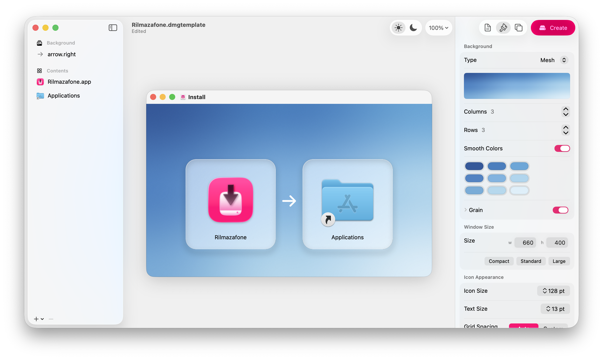
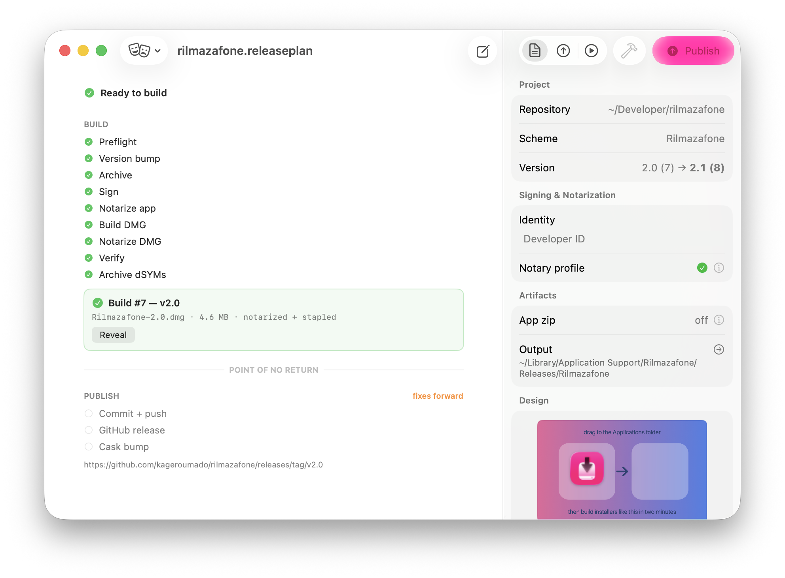

# Rilmazafone

Rilmazafone combines visual DMG design with the release pipeline in one saved document. Arrange the installer as it will appear in Finder, then archive the app and publish it to GitHub from the same release plan.

## Highlights

- Design a DMG as it will appear in Finder, then publish from the same release plan.
- Save the installer layout and release configuration for repeatable releases.
- Run the saved release plan from either the app or CLI.

Full feature list

- Arrange app icons, files, and the Applications shortcut on a visual canvas.
- Compose backgrounds with images, gradients, text, and glass panels.
- Save reusable `.dmgtemplate` designs and `.releaseplan` configurations.
- Archive, sign, notarize, package, and verify app and DMG artifacts.
- Publish GitHub releases and update a Homebrew cask.
- CLI commands for DMG generation and release build/publish.
- Undo/redo, portable source paths, and Finder thumbnails in the GitHub edition.

## Notes

- macOS 26+; Xcode for the release pipeline.
- Homebrew: `brew install --cask kageroumado/tap/rilmazafone`.
- The App Store edition contains the designer; the GitHub edition adds the CLI and release pipeline. [Edition differences](REFERENCE.md#build-variants) · [Workflow and formats](REFERENCE.md).
